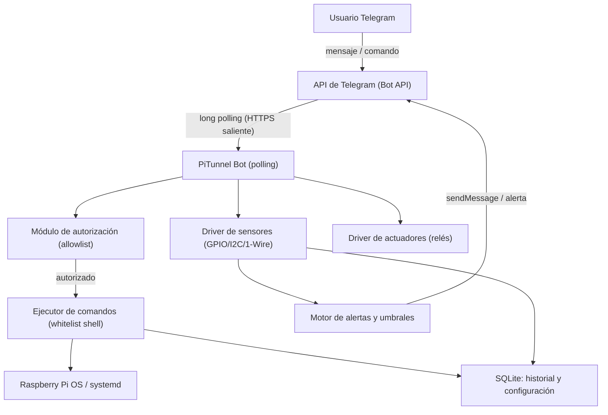
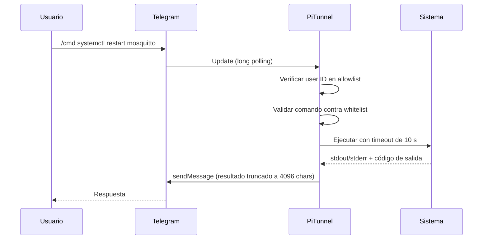

# Especificación del Servicio: PiTunnel — Control remoto de Raspberry Pi vía Telegram

**Versión:** 1.0 · **Estado:** Borrador · **Fecha:** 2026-10-30

## 1. Visión general y objetivos

PiTunnel es un servicio hospedado en una Raspberry Pi que permite a un usuario autorizado controlar y monitorizar el dispositivo (y los sensores/actuadores conectados) desde cualquier lugar mediante un bot de Telegram, sin exponer puertos públicos ni depender de servicios de terceros beyond la propia API de Telegram.

**Objetivos:**

- Ejecutar comandos de forma segura en la Pi (reboot, servicios, estado del sistema).
- Leer el estado de sensores (temperatura, humedad, GPIO, cámaras) bajo demanda.
- Recibir notificaciones proactivas (alertas de umbral, eventos, caídas de servicio).
- Accionar dispositivos de domótica conectados (relés, LEDs, interruptores inteligentes).
- Operar 24/7 con bajo consumo y recuperación automática ante fallos.

**No objetivos (v1):**

- Soporte multiusuario con roles complejos (v1 permite varios usuarios autorizados con permisos idénticos).
- Compatibilidad con plataformas de mensajería distintas de Telegram.
- Voz/videollamadas.

## 2. Requisitos

### 2.1 Requisitos funcionales

| ID | Requisito | Prioridad |
|----|-----------|-----------|
| RF-01 | El bot solo responde a usuarios autorizados (allowlist de Telegram user IDs); ignora y registra a los demás. | Alta |
| RF-02 | Comando `/status`: CPU, RAM, temperatura, disco, uptime, IP local y pública. | Alta |
| RF-03 | Comando `/cmd <comando>`: ejecuta comandos de shell desde una lista blanca configurable. | Alta |
| RF-04 | Comando `/sensors`: devuelve lecturas actuales de todos los sensores registrados. | Alta |
| RF-05 | Comandos de actuación: `/on <id>`, `/off <id>` para relés/GPIO registrados. | Alta |
| RF-06 | Notificaciones proactivas: alertas por umbral (p. ej. temp > 70 °C), eventos de hardware y reinicios del servicio. | Alta |
| RF-07 | Botones inline (InlineKeyboard) para acciones frecuentes y confirmaciones peligrosas. | Media |
| RF-08 | Comando `/help` con lista dinámica de comandos según el perfil de usuario. | Media |
| RF-09 | Historial de comandos ejecutados con timestamp, usuario y resultado (retención configurable, por defecto 30 días). | Media |
| RF-10 | Comando `/snapshot`: captura de cámara (Picam/USB) enviada como foto. | Baja |
| RF-11 | Soporte de comandos en español e inglés (respuestas localizadas). | Baja |

### 2.2 Requisitos no funcionales

| ID | Requisimento | Meta |
|----|--------------|------|
| RNF-01 | Latencia de respuesta a comando | < 2 s (P95) en red doméstica |
| RNF-02 | Disponibilidad del servicio | ≥ 99 % (reinicios automáticos vía systemd) |
| RNF-03 | Consumo de recursos del bot | < 60 MB RAM, < 5 % CPU sostenida |
| RNF-04 | Arranque tras fallo eléctrico | Recuperación automática (< 60 s) |
| RNF-05 | Seguridad | Sin puertos abiertos entrantes; token y secretos fuera del repositorio |
| RNF-06 | Observabilidad | Logs estructurados (JSON) + métricas Prometheus opcionales |
| RNF-07 | Mantenibilidad | Configuración 100 % declarativa (YAML + variables de entorno) |

## 3. Arquitectura

### 3.1 Diagrama de componentes



### 3.2 Flujo de un comando



### 3.3 Decisiones de diseño

| Decisión | Elección | Justificación |
|----------|----------|---------------|
| Recepción de mensajes | Long polling (no webhook) | Evita puertos abiertos y certificados; funciona tras CGNAT. |
| Lenguaje | Python 3.11+ con `python-telegram-bot` v21 | Madurez de la librería, fácil acceso a GPIO vía `gpiozero`/`smbus2`. |
| Persistencia | SQLite (WAL) | Sin servidor de BD, suficiente para historial y configuración. |
| Ejecución de comandos | Whitelist + `subprocess` con argumentos fijos | Nunca shell interpolation de entrada del usuario. |
| Aislamiento | Servicio systemd dedicado, usuario no root (`pitunnel`), grupos `gpio`, `i2c`, `video` | Principio de mínimo privilegio. |
| Configuración | `config.yaml` + secretos en `EnvironmentFile` (permisos 600) | Separación de configuración y credenciales. |

## 4. Interfaz de comandos (API de usuario)

Todos los comandos se emiten como mensajes de Telegram al bot. Prefijo de administrador: opcional confirmación con botón inline para acciones destructivas.

| Comando | Argumentos | Descripción | Confirmación |
|---------|-----------|-------------|--------------|
| `/start` | — | Registro del chat ID y bienvenida. | No |
| `/help` | — | Lista de comandos disponibles. | No |
| `/status` | — | Estado del sistema (CPU, RAM, temp, disco, red). | No |
| `/sensors` | `[id]` | Lectura de uno o todos los sensores. | No |
| `/on` / `/off` | `<id>` | Activa/desactiva un actuador registrado. | Configurable |
| `/cmd` | `<alias>` | Ejecuta un alias de la whitelist (p. ej. `restart-mqtt`). | Sí (destructivos) |
| `/snapshot` | — | Foto de la cámara conectada. | No |
| `/alerts` | — | Lista de reglas de alerta activas. | No |
| `/history` | `[n]` | Últimos n comandos ejecutados (def. 10). | No |

**Formato de respuesta:** texto plano con Markdown de Telegram; resultados de shell en bloque `monoespaciado`; respuestas > 4096 caracteres se truncan con sufijo `… (truncado)` o se envían como documento.

**Errores estándar:**

| Código interno | Mensaje al usuario |
|----------------|---------------------|
| E_UNAUTHORIZED | "⛔ No estás autorizado para usar este bot." |
| E_UNKNOWN_CMD | "❓ Comando no reconocido. Usa /help." |
| E_WHITELIST | "🚫 Comando fuera de la lista permitida." |
| E_TIMEOUT | "⏱ Tiempo de espera agotado (10 s)." |
| E_SENSOR | "🌡 Sensor <id> no disponible." |
| E_INTERNAL | "⚠ Error interno. Revisa los logs." |

## 5. Modelo de configuración (`config.yaml`, esquema resumido)

```yaml
telegram:
  # el token vive en el EnvironmentFile, nunca aquí
  authorized_users: [123456789]
  language: es

commands:
  aliases:
    restart-mqtt: "systemctl restart mosquitto"
    disk-usage: "df -h /"

sensors:
  - id: temp-salon
    type: dht22
    pin: 4
    interval_s: 60
    alert:
      when: "> 27.5"
      cooldown_min: 30

actuators:
  - id: luz-porche
    type: relay
    pin: 17
    confirm: false

limits:
  command_timeout_s: 10
  max_output_chars: 4000
  history_retention_days: 30
```

## 6. Seguridad

1. **Autorización:** allowlist estricta de `user_id`; todo mensaje ajeno se ignora y se registra (`WARNING`).
2. **Token:** `TELEGRAM_BOT_TOKEN` en `/etc/pitunnel.env` (600, usuario `pitunnel`). Rotación documentada.
3. **Ejecución restringida:** solo alias predefinidos; `subprocess.run([...], shell=False)`, con timeout y límite de salida. Ningún comando construido concatenando texto del usuario.
4. **Red:** únicamente conexiones salientes a `api.telegram.org` (443). UFW con política deny incoming.
5. **Confirmaciones:** acciones marcadas `destructive` requieren pulsar un botón inline (callback con expiración de 60 s).
6. **Auditoría:** log inmutable en SQLite de cada comando (usuario, timestamp, alias, código de salida).
7. **Ficheros:** servicio ejecuta como usuario sin privilegios; acceso a hardware mediante grupos de Linux, no root.

## 7. Despliegue

### 7.1 Requisitos de hardware/software

- Raspberry Pi 3B+ o superior (recomendado Pi 4/5 con 2 GB RAM), Raspberry Pi OS Lite (64 bits).
- MicroSD ≥ 16 GB (A1) o arranque desde SSD.
- Conectividad: Ethernet o Wi-Fi con IP reservada (DHCP estático); salida a Internet sin puertos entrantes.
- Python 3.11+, `systemd`, `sqlite3`.

### 7.2 Pasos

1. Crear bot con @BotFather y obtener token.
2. Crear usuario y grupos: `sudo useradd -r -m -G gpio,i2c,video pitunnel`.
3. Instalar dependencias: `pip install -r requirements.txt` (en venv) o paquete `.deb`/contenedor.
4. Desplegar `config.yaml` en `/etc/pitunnel/config.yaml` y secretos en `/etc/pitunnel.env`.
5. Instalar unidad systemd:

```ini
[Unit]
Description=PiTunnel Telegram Service
After=network-online.target
Wants=network-online.target

[Service]
User=pitunnel
EnvironmentFile=/etc/pitunnel.env
ExecStart=/opt/pitunnel/venv/bin/python -m pitunnel.main
Restart=always
RestartSec=5
WatchdogSec=60

[Install]
WantedBy=multi-user.target
```

6. `sudo systemctl enable --now pitunnel`.
7. Verificación: `/start`, `/status` y `/sensors` desde un usuario autorizado; comprobar `journalctl -u pitunnel -f`.

### 7.3 Actualización y rollback

- Despliegue con versión inmutable en `/opt/pitunnel/<version>/` y symlink `current`.
- Rollback = repuntar symlink + `systemctl restart`.
- Migraciones de SQLite automáticas y compatibles hacia atrás (1 versión).

## 8. Casos de prueba de aceptación

| ID | Escenario | Resultado esperado |
|----|-----------|--------------------|
| CA-01 | Usuario no autorizado envía `/status` | Sin respuesta; log `WARNING` con user ID. |
| CA-02 | `/status` con carga normal | Respuesta < 2 s con todas las métricas. |
| CA-03 | `/cmd` alias destructivo | Botón de confirmación; ejecuta solo tras pulsar. |
| CA-04 | Sensor DHT22 supera umbral | Alerta única; sin repetición hasta cooldown. |
| CA-05 | Corta la red 5 min | Reintento con backoff; recupera y procesa mensajes encolados. |
| CA-06 | Reinicio de la Pi | Servicio activo < 60 s tras el arranque; notifica "servicio en línea". |
| CA-07 | Salida de comando > 4096 chars | Respuesta truncada o enviada como documento. |

## 9. Roadmap posterior a v1

- v1.1: panel de administración vía comando `/config` (alta/baja de sensores sin reiniciar).
- v1.2: métricas Prometheus + dashboard Grafana local.
- v1.3: roles de usuario (admin / lector) y multi-idioma completo.
- v2.0: plugin de domótica MQTT (integración Home Assistant).